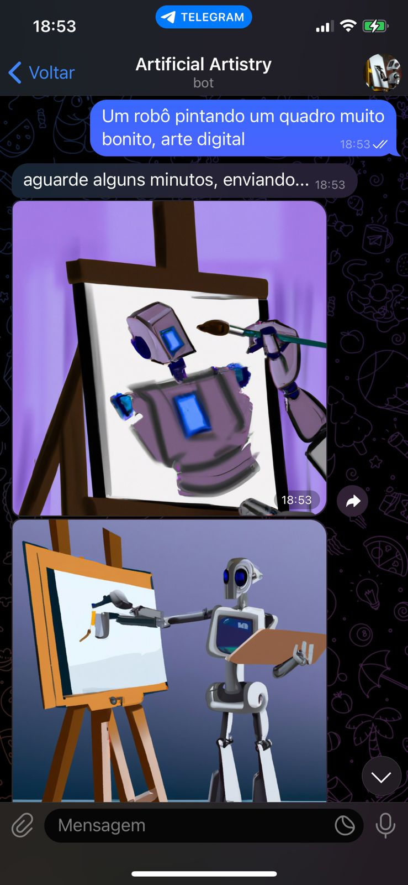
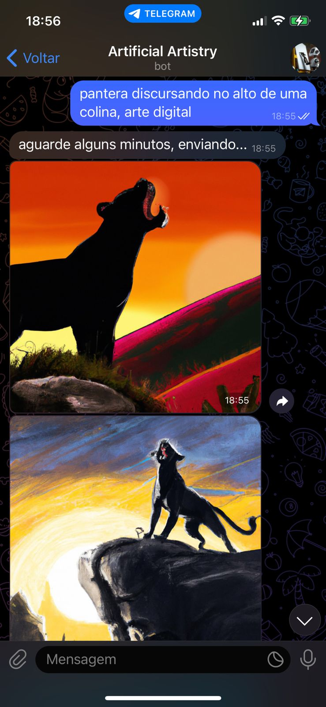

## 🤖 Artificial Artistry


<h1 align="center">

</h1>

<br>

## 🧪 Tecnologias

Esse projeto foi desenvolvido com as seguintes tecnologias:

- [Node.js](https://nodejs.org/en/) 22.9+
- Geração de imagens com provedor à sua escolha: [OpenAI](https://platform.openai.com/), [Cloudflare Workers AI](https://developers.cloudflare.com/workers-ai/) ou [Pollinations](https://pollinations.ai/)
- [telegraf](https://telegraf.js.org/)

## 🚀 Como executar

Clone o projeto e acesse a pasta do mesmo.

Para iniciá-lo, siga os passos abaixo:
```bash
# Instalar as dependências
$ yarn
# Criar o arquivo de configuração e preencher os tokens
$ cp .env.example .env
# Iniciar o projeto (ou `yarn dev` para reiniciar automaticamente ao salvar)
$ yarn start
```

### Escolhendo o provedor de imagens

Defina `IMAGE_PROVIDER` no `.env` e preencha as credenciais do provedor escolhido:

| Provedor | `IMAGE_PROVIDER` | Custo | Variáveis | Modelo padrão |
| --- | --- | --- | --- | --- |
| OpenAI | `openai` | Pago por imagem | `OPENAI_API_KEY` | `gpt-image-2.5-flare` |
| Cloudflare Workers AI | `cloudflare` | Grátis até 10.000 neurons/dia (~57 a ~230 imagens) | `CLOUDFLARE_ACCOUNT_ID`, `CLOUDFLARE_API_TOKEN` | `@cf/black-forest-labs/flux-1-schnell` |
| Pollinations | `pollinations` | Grátis sem conta (1 imagem a cada 45s) ou com chave | `POLLINATIONS_API_KEY` (opcional) | `black-forest-labs/flux.1-schnell` |

Sempre é necessário o `TOKEN_TELEGRAM_BOT`, gerado pelo [@BotFather](https://t.me/BotFather). As demais opções (modelo, tamanho, quantidade de imagens, cooldown e lista de usuários permitidos) estão no [.env.example](.env.example).

> Dica: no Pollinations sem chave, use `IMAGE_COUNT=1`; cada imagem extra adiciona ~45s de espera.

### Adicionando outro provedor

Crie um arquivo em `src/providers/` que exporte `create({ model })` retornando `{ model, generate(prompt, { count, size, userId }) }`, onde `generate` devolve uma lista de `Buffer` com as imagens. Depois registre-o em [src/providers/index.js](src/providers/index.js).

## 💻 Projeto

O Artificial Artistry é um bot no telegram que gera imagens com IA: basta escrever algo e ele retornará imagens baseadas no texto, enviadas em um único álbum.

<h1 align="center">
    
</h1>

<h1 align="center">
    
</h1>

## ⚙️ Como funciona

- Cada usuário pode ter um pedido em andamento por vez, e precisa esperar `COOLDOWN_SECONDS` entre pedidos. Pedidos que falham não contam para essa espera.
- A geração roda em segundo plano, então um pedido demorado não trava o bot para os outros usuários.
- Enquanto a imagem é gerada, o chat mostra o status "enviando foto…". As imagens chegam em um único álbum, com o texto do pedido como legenda.
- O bot só aceita mensagens de texto e responde com uma ajuda para figurinhas, fotos ou comandos desconhecidos.
- Pedidos bloqueados pelo filtro de segurança, excesso de pedidos e limite de uso atingido geram mensagens de erro específicas.
- Se faltar alguma variável obrigatória no `.env`, o bot avisa e encerra ao iniciar.
- **Pollinations sem chave:** o limite é por IP, então os pedidos de todos os usuários entram numa fila, com uma imagem a cada ~45s e tamanho máximo de 768×768.
- **OpenAI:** o bot envia um identificador anônimo de cada usuário (hash do ID do Telegram), que a OpenAI usa para detectar abusos sem receber o ID real.

## ⚠️ Limitações conhecidas

- **Cloudflare:** os modelos FLUX.2 usam um formato de envio diferente (multipart), que ainda não é suportado. Funcionam o `@cf/black-forest-labs/flux-1-schnell` (padrão), o `@cf/leonardo/lucid-origin` e o `@cf/leonardo/phoenix-1.0`.
- **Cloudflare `flux-1-schnell`:** o modelo não aceita semente (seed) nem tamanho. `IMAGE_SIZE` é ignorado e, se o mesmo texto gerar imagens repetidas, use `IMAGE_COUNT=1` ou outro modelo.
- **Pollinations com chave:** a documentação da API nova não confirma se a semente e o tamanho são aceitos. O bot envia só uma semente aleatória.
- **Custo da OpenAI:** cada mensagem gera `IMAGE_COUNT` imagens pagas. Num bot público, use `COOLDOWN_SECONDS`, `ALLOWED_USER_IDS` ou valores menores de `IMAGE_COUNT` e `OPENAI_IMAGE_QUALITY`.
- O cooldown e a fila ficam na memória, então reiniciar o bot zera esse controle.

## 🔎 Outras opções de IA pesquisadas

Levantamento feito em novembro de 2026. Preços e limites mudam com frequência, então confira no site de cada serviço.

| Serviço | Grátis? | Observação |
| --- | --- | --- |
| OpenAI GPT Image 2.5 | Não | Entre as melhores em qualidade. A variante `flare` é a mais rápida; a `sunburst` tem mais detalhe, com o mesmo preço |
| Cloudflare Workers AI | Sim, 10.000 neurons/dia | Melhor opção gratuita: a cota diária se renova e não pede cartão |
| Pollinations | Sim, com limite | Funciona sem conta, mas sem garantia de estabilidade |
| Together AI (`FLUX.1-schnell-Free`) | Talvez | Começou como promoção em 2024, não está claro se continua |
| Leonardo AI | US$5 ao criar a conta | Crédito único, depois é pago |
| Hugging Face | US$0,10/mês | Dá para poucas imagens |
| Google Gemini / Imagen | Não (na API) | O grátis restante é só no app Gemini |
| FLUX.2 Pro (via fal.ai e outros) | Não | Indicado para fotorrealismo |

Fontes: [Cloudflare Workers AI](https://developers.cloudflare.com/workers-ai/models/flux-1-schnell/), [cota grátis da Cloudflare](https://toolfreebie.com/cloudflare-workers-ai/), [documentação do Pollinations](https://github.com/pollinations/pollinations/blob/master/APIDOCS.md), [Together AI](https://together.ai/models/flux-1-schnell), [preços do Hugging Face](https://huggingface.co/docs/inference-providers/pricing), [Gemini sem plano grátis na API](https://blog.laozhang.ai/en/posts/nano-banana-api-pricing-free-vs-pro), [GPT Image 2.5 Flare vs Sunburst](https://myclaw.ai/blog/gpt-image-2-5-sunburst-vs-flare), [comparativo de APIs gratuitas](https://apiframe.ai/blog/free-ai-image-generation-api-2026).

## 📝 O que mudou nesta versão

- O DALL·E 2, usado até então, foi desligado pela OpenAI em maio de 2026, e o bot parou de funcionar. O padrão agora é o `gpt-image-2.5-flare`.
- O provedor de imagens passou a ser configurável (OpenAI, Cloudflare ou Pollinations).
- O SDK da OpenAI foi atualizado da v3 para a v7, e o Telegraf para a 4.16.
- O `dotenv` foi removido: o Node carrega o `.env` direto, com `--env-file` (por isso o Node 22.9+).
- Antes, um pedido demorado travava o bot para todos os usuários. Agora a geração roda em segundo plano.
- A mensagem "aguarde" chegava depois das imagens. Agora vem antes, e as imagens chegam num álbum em vez de avulsas.
- Figurinhas e fotos causavam erro. Foram adicionados `/help`, cooldown, limite de tamanho do texto e a lista de usuários permitidos.
- A chave da OpenAI passou a se chamar `OPENAI_API_KEY`. O nome antigo, `TOKEN_CHATGPT_IMG`, continua aceito.

## 🔖 Deploy

O bot está disponível no telegram e pode ser acessado [clicando aqui](https://t.me/ArtificialArtistryBot)
